# Provider Data Factory

NestJS-based data processing service that reads raw provider data from MongoDB, processes it asynchronously through BullMQ and Redis, and writes normalized domain data into a separate MongoDB database.

Current provider: **Talabat**

---

## Tech Stack

- NestJS
- TypeScript
- MongoDB
- Mongoose
- BullMQ
- Redis
- Zod
- Docker Compose
- Vitest

---

## Architecture

```text
                JSON Source Files
                       |
                       v
                  Seed Script
                       |
                       v
              +----------------+
              |  provider_raw  |
              |----------------|
              | locations      |
              | restaurants    |
              | menus          |
              +----------------+
                       |
                MongoDB Cursor
                       |
                       v
              FactoryDispatcher
                       |
                 Batch Jobs
                       |
                       v
              +----------------+
              | BullMQ / Redis |
              +----------------+
                       |
                       v
               FactoryProcessor
                       |
                       v
                TalabatAdapter
                       |
          +------------+------------+
          |            |            |
       Validate     Normalize       Map
          |            |            |
          +-------- Deduplicate -----+
                       |
                       v
                 Repositories
                       |
              Deterministic Upsert
                       |
                       v
             +----------------------+
             |   provider_domain    |
             |----------------------|
             | locations            |
             | restaurants          |
             | restaurant_locations |
             | menu_categories      |
             | menu_items           |
             | runs                 |
             | quarantine           |
             +----------------------+
```

For more design details, see:

```text
ARCHITECTURE.md
```

---

# Database Design

The project uses two MongoDB databases.

## Raw Database

```text
provider_raw
```

Collections:

```text
locations
restaurants
menus
```

The raw database stores the original provider responses.

The factory treats this database as read-only during processing.

---

## Domain Database

```text
provider_domain
```

Collections:

```text
locations
restaurants
restaurant_locations
menu_categories
menu_items
runs
quarantine
```

This database contains normalized application data.

---

# MongoDB Screenshots

MongoDB screenshots were captured using MongoDB Compass connected to:

```text
mongodb://localhost:27017
```

Screenshots are stored under:

```text
docs/providerDb/
docs/providerDomain/
```

---

## Raw Provider Database

The `provider_raw` database contains the original source collections.

### Raw Locations

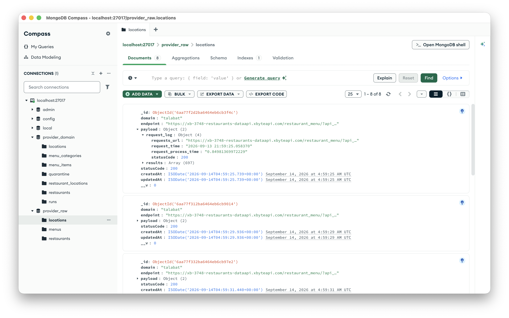

### Raw Location Detail

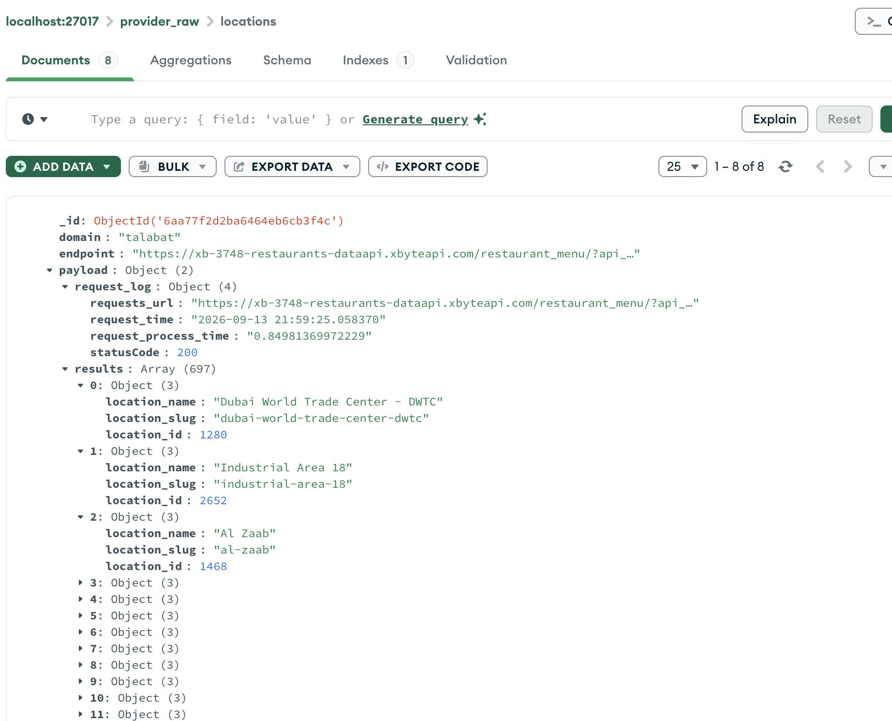

### Raw Restaurants

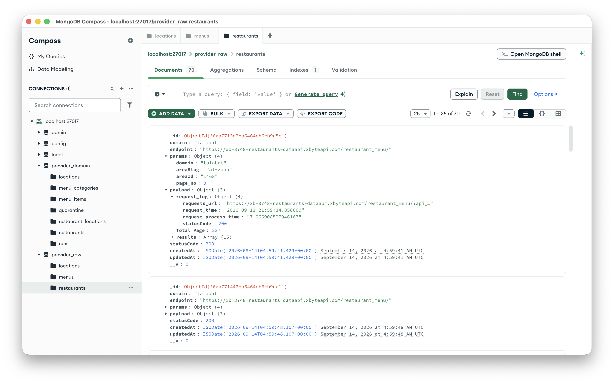

### Raw Restaurant Detail

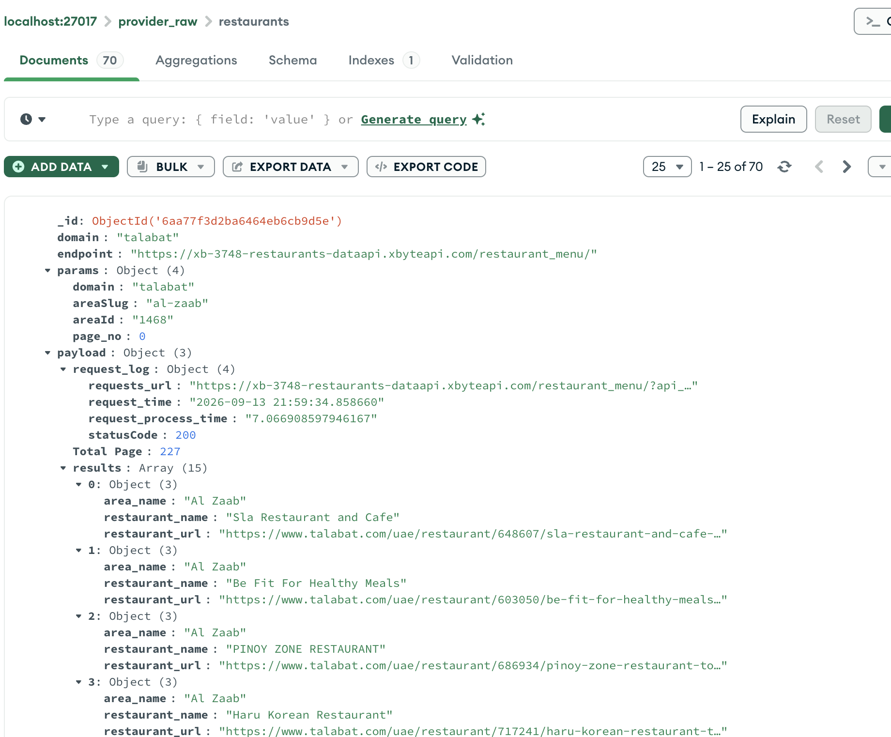

### Raw Menu

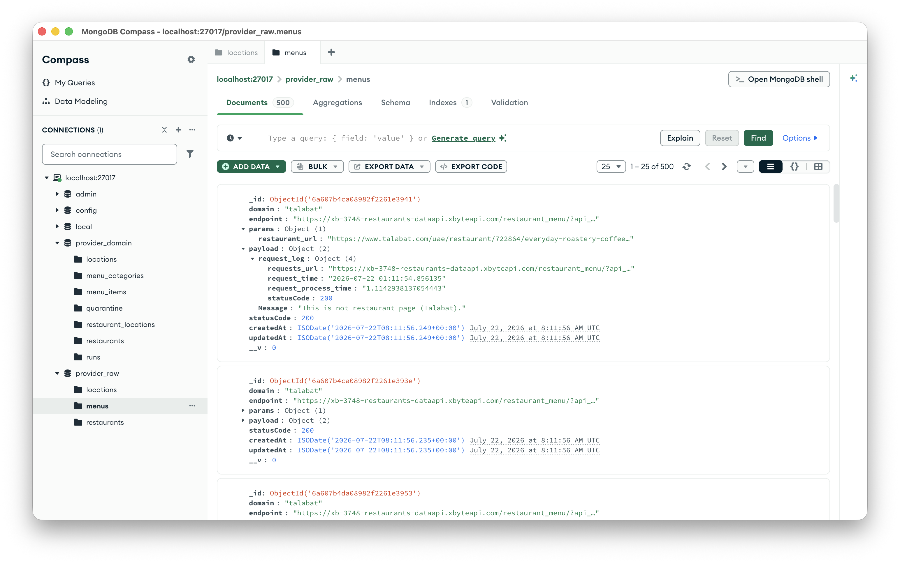

---

# Normalized Domain Database

The `provider_domain` database contains the normalized entities generated by the factory.

### Domain Collections

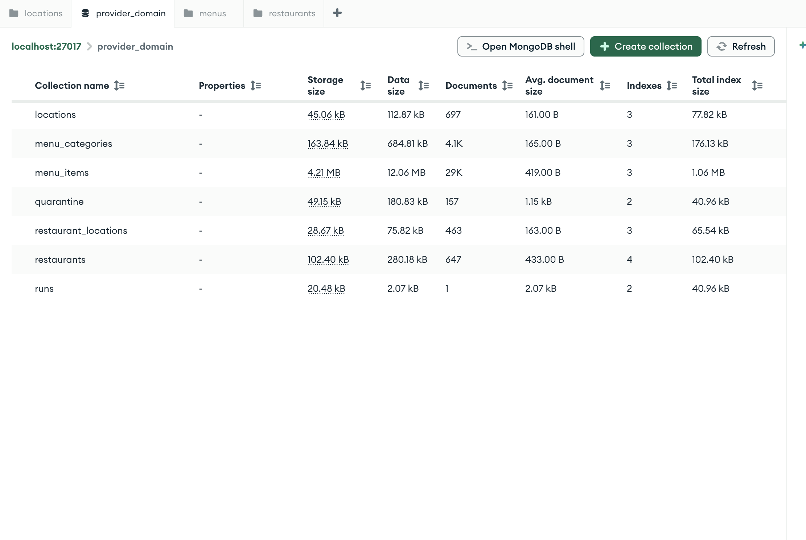

### Normalized Restaurant

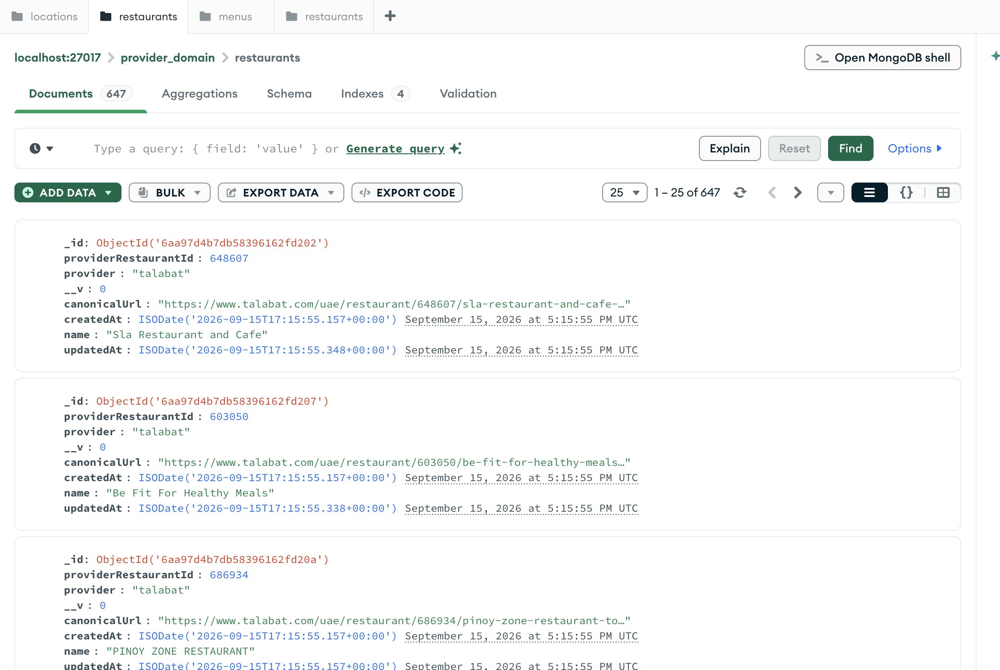

### Restaurant Locations

The `restaurant_locations` collection stores restaurant-to-location relationships.

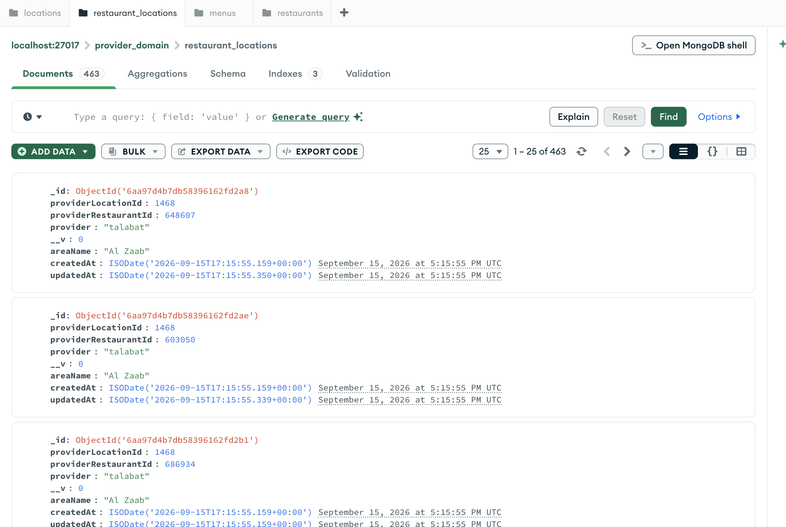

### Menu Categories

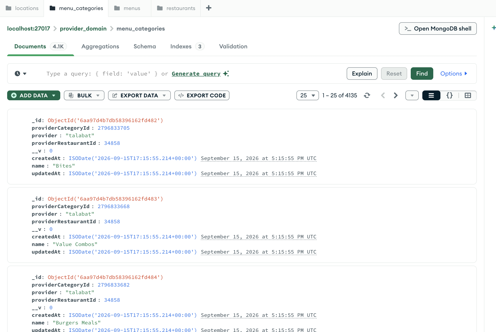

### Run Tracking

Each execution creates a run document containing:

```text
runId
status
expectedJobs
completedJobs
failedJobs
counters
stages
sampleErrors
startedAt
completedAt
durationMs
```

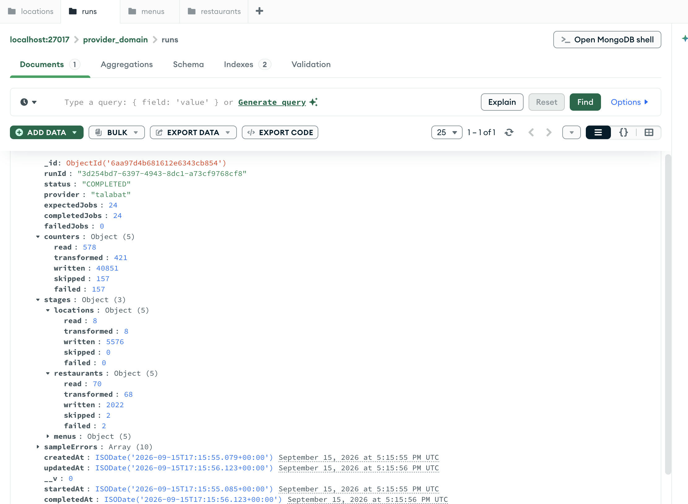

### Quarantine

Invalid provider documents are stored in the quarantine collection instead of being silently discarded.

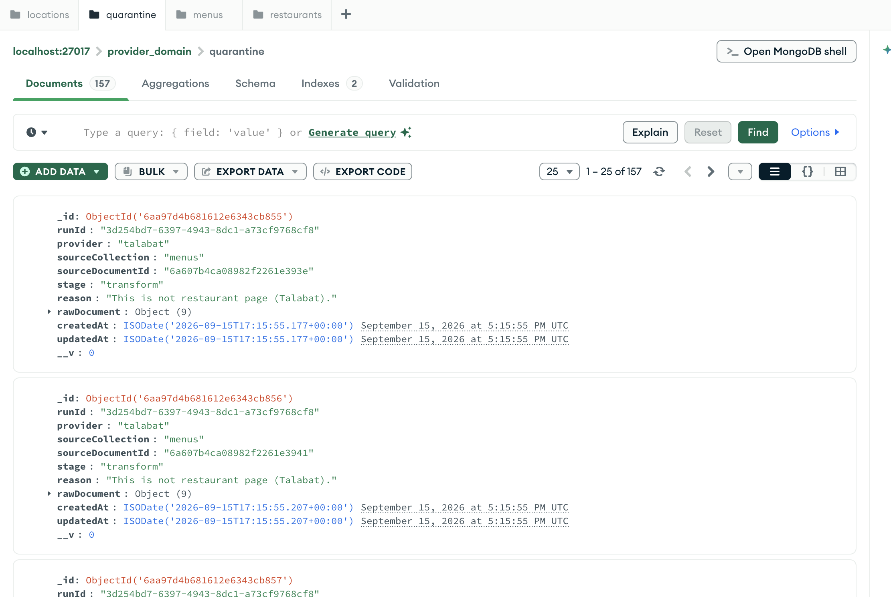

---

# Source Data Notes

Important observations found while analyzing the provided dataset:

- numeric fields may arrive as strings or numbers
- locations can appear multiple times across raw provider responses
- restaurants may appear in multiple areas
- restaurant URLs contain restaurant and area identifiers
- menu `outletCode` is used as the provider restaurant identifier
- menu payload `id` may differ from `outletCode`
- some successful provider responses still contain business-level errors
- optional fields can be `null` or missing

Examples of semantic provider errors:

```text
Page limit exceeded.
This is not restaurant page (Talabat).
```

These documents are quarantined instead of silently dropped.

---

# Natural Keys

The normalized collections use deterministic provider-based keys.

```text
Location
(provider, providerLocationId)

Restaurant
(provider, providerRestaurantId)

RestaurantLocation
(provider, providerRestaurantId, providerLocationId)

MenuCategory
(provider, providerRestaurantId, providerCategoryId)

MenuItem
(provider, providerRestaurantId, providerItemId)
```

MongoDB unique indexes and upserts prevent duplicate domain records.

---

# Processing Pipeline

Each source document follows:

```text
Validate
   ↓
Normalize
   ↓
Map
   ↓
Deduplicate
   ↓
Upsert
```

Provider-specific logic is isolated under:

```text
src/providers/talabat/
```

The adapter handles:

```text
provider validation
field normalization
URL parsing
identifier extraction
semantic provider errors
domain mapping
```

Repositories handle persistence.

---

# Queue Processing

The application uses BullMQ and Redis for asynchronous batch processing.

Main queue:

```text
provider-factory
```

Dead-letter queue:

```text
provider-factory-dlq
```

Job types:

```text
location-batch
restaurant-batch
menu-batch
```

The dispatcher reads source collections with MongoDB cursors and creates jobs containing only source document IDs.

```text
MongoDB Cursor
      |
25 document IDs
      |
      v
BullMQ Job
```

This avoids loading entire collections into memory and keeps Redis payloads small.

---

# Environment Variables

Create `.env` from `.env.example`.

Example for local development:

```env
NODE_ENV=development
PORT=3000

RAW_MONGODB_URI=mongodb://localhost:27017/provider_raw
DOMAIN_MONGODB_URI=mongodb://localhost:27017/provider_domain

REDIS_HOST=localhost
REDIS_PORT=6379

FACTORY_BATCH_SIZE=25
FACTORY_CONCURRENCY=5
```

---

# Install Dependencies

```bash
npm install
```

---

# Run Locally

Start MongoDB and Redis:

```bash
docker compose up -d mongo redis
```

Verify:

```bash
docker compose ps
```

Seed raw data:

```bash
npm run seed
```

Start NestJS:

```bash
npm run start:dev
```

---

# Run With Docker Compose

Build and start all services:

```bash
docker compose up --build -d
```

Check services:

```bash
docker compose ps
```

Expected:

```text
provider-factory-app
provider-factory-mongo
provider-factory-redis
```

Seed the raw database:

```bash
docker compose --profile tools run --rm seed
```

View application logs:

```bash
docker compose logs -f app
```

Stop services:

```bash
docker compose down
```

For a complete clean reset including MongoDB and Redis volumes:

```bash
docker compose down -v
```

After using `docker compose down -v`, seed the raw database again before starting a factory run.

---

# API

The service exposes:

```text
GET  /health
POST /runs
GET  /runs/:id
GET  /runs/:id/errors
```

API screenshots are stored under:

```text
docs/api/
```

---

## Health Check

Request:

```http
GET /health
```

Command:

```bash
curl http://localhost:3000/health
```

Example response:

```json
{
  "status": "ok",
  "services": {
    "rawMongo": {
      "status": "up"
    },
    "domainMongo": {
      "status": "up"
    },
    "redis": {
      "status": "up"
    }
  }
}
```

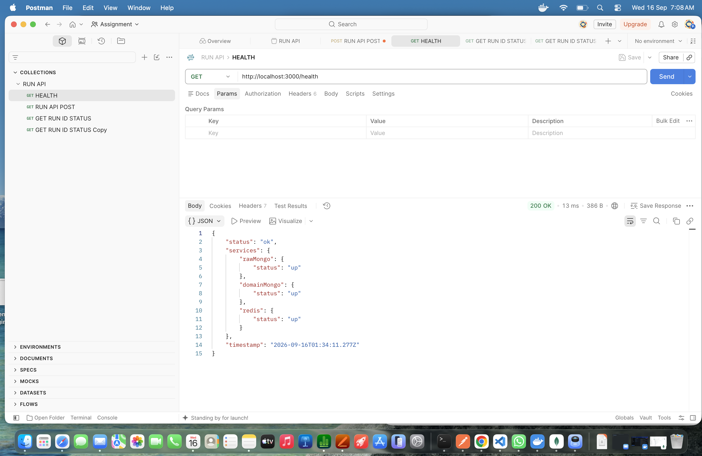

---

## Trigger a Factory Run

Request:

```http
POST /runs
```

Command:

```bash
curl -X POST http://localhost:3000/runs
```

Example response:

```json
{
  "runId": "3d254bd7-6397-4943-8dc1-a73cf9768cf8",
  "status": "RUNNING",
  "jobsQueued": 24
}
```

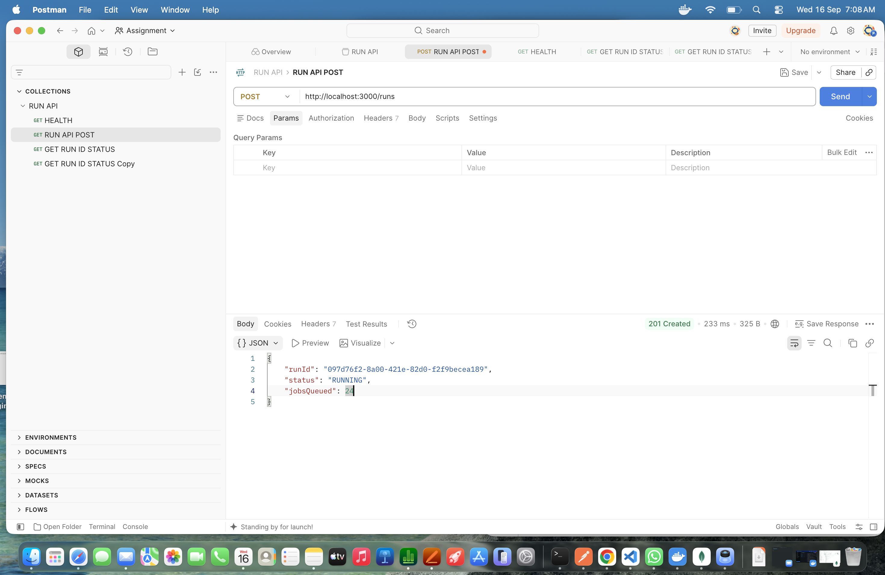

---

## Get Run Status

Request:

```http
GET /runs/:id
```

Example:

```bash
curl http://localhost:3000/runs/3d254bd7-6397-4943-8dc1-a73cf9768cf8
```

Example completed response:

```json
{
  "runId": "3d254bd7-6397-4943-8dc1-a73cf9768cf8",
  "status": "COMPLETED",
  "provider": "talabat",
  "expectedJobs": 24,
  "completedJobs": 24,
  "failedJobs": 0,
  "counters": {
    "read": 578,
    "transformed": 421,
    "written": 40851,
    "skipped": 157,
    "failed": 157
  },
  "stages": {
    "locations": {
      "read": 8,
      "transformed": 8,
      "written": 5576,
      "skipped": 0,
      "failed": 0
    },
    "restaurants": {
      "read": 70,
      "transformed": 68,
      "written": 2022,
      "skipped": 2,
      "failed": 2
    },
    "menus": {
      "read": 500,
      "transformed": 345,
      "written": 33253,
      "skipped": 155,
      "failed": 155
    }
  }
}
```

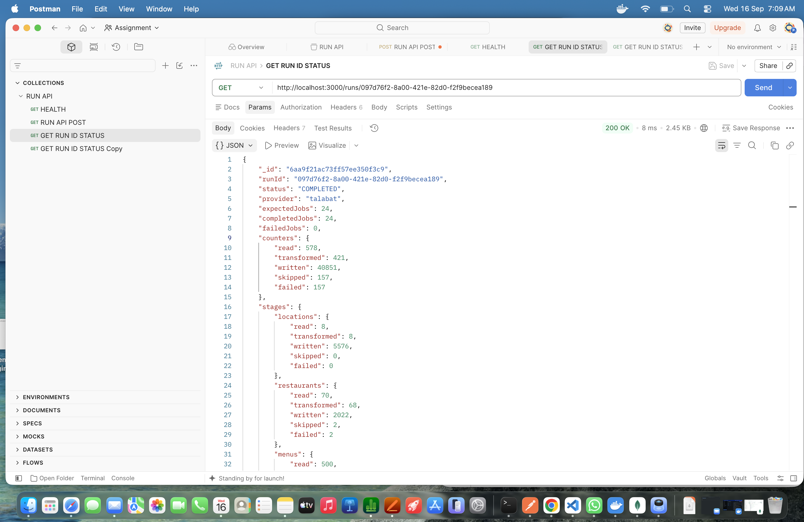

---

# Understanding the Written Counter

`written` represents normalized write/upsert operations generated during processing.

It does not necessarily equal the final number of unique MongoDB documents.

Example:

```text
location occurrences processed: 5576
unique normalized locations:     approximately 697
```

The same provider location may appear in multiple raw responses.

MongoDB unique indexes ensure the final domain collection remains deduplicated.

---

# Quarantine Errors

Request:

```http
GET /runs/:id/errors
```

Example:

```bash
curl "http://localhost:3000/runs/3d254bd7-6397-4943-8dc1-a73cf9768cf8/errors?page=1&limit=10"
```

Example response:

```json
{
  "items": [
    {
      "runId": "3d254bd7-6397-4943-8dc1-a73cf9768cf8",
      "provider": "talabat",
      "sourceCollection": "menus",
      "stage": "menus",
      "reason": "This is not restaurant page (Talabat)."
    }
  ],
  "pagination": {
    "page": 1,
    "limit": 10,
    "total": 157,
    "totalPages": 16
  }
}
```

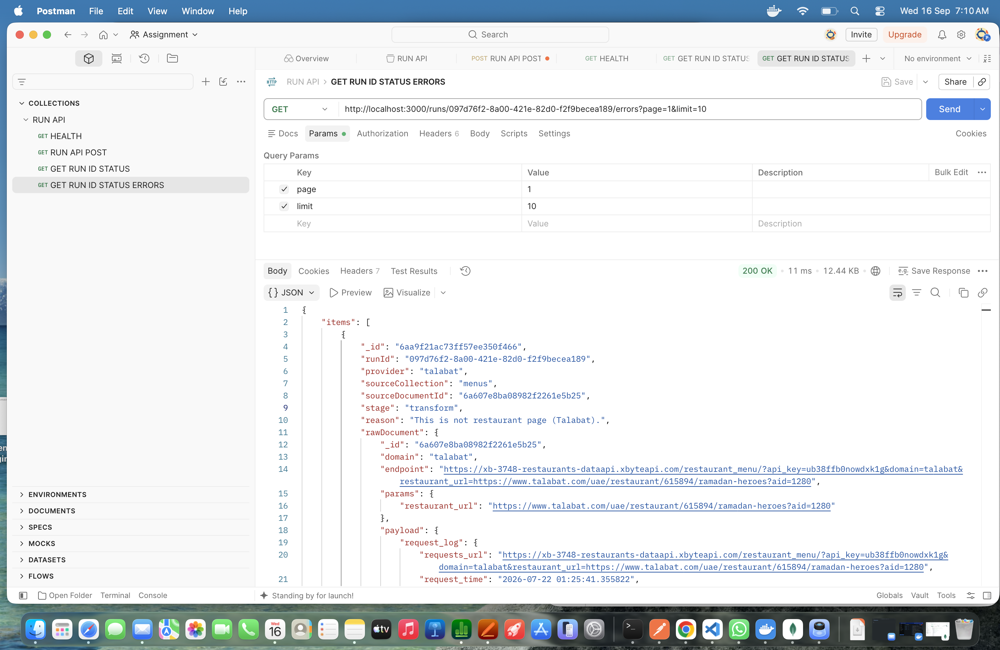

---

# Pagination Test

Page 1:

```bash
curl "http://localhost:3000/runs/YOUR_RUN_ID/errors?page=1&limit=10"
```

Page 2:

```bash
curl "http://localhost:3000/runs/YOUR_RUN_ID/errors?page=2&limit=10"
```

For:

```text
total = 157
limit = 10
```

the expected result is:

```text
page 1  → 10 records
page 2  → 10 records
...
page 16 → 7 records
```

---

# Error Handling

The system distinguishes between provider-data failures and infrastructure failures.

## Provider Data Failure

Examples:

```text
invalid schema
missing provider identifier
Page limit exceeded
invalid restaurant page
```

Behavior:

```text
Quarantine
    ↓
Update counters
    ↓
Continue processing
```

---

## Infrastructure Failure

Examples:

```text
MongoDB unavailable
repository write failure
unexpected dependency failure
```

Behavior:

```text
Job failure
    ↓
BullMQ retry
    ↓
Exponential backoff
    ↓
Retry exhaustion
    ↓
Dead-letter queue
```

---

# Idempotency

The pipeline can be run multiple times against the same source data.

Repositories use deterministic MongoDB upserts.

```text
same source data
      ↓
run factory again
      ↓
same domain entities updated
```

The normalized collection counts should remain stable instead of doubling.

To test:

```bash
curl -X POST http://localhost:3000/runs
```

Wait for completion and trigger another run.

---

# Resumability

BullMQ persists queued jobs in Redis.

If the worker restarts, unfinished jobs can be retried.

Because domain writes are idempotent, retrying a batch does not create duplicate domain records.

Current limitation:

run counters may be incremented more than once if a job partially processes data before retrying.

---

# Production-Like Testing

Start from a clean environment:

```bash
docker compose down -v
```

Build and start:

```bash
docker compose up --build -d
```

Seed:

```bash
docker compose --profile tools run --rm seed
```

Check health:

```bash
curl http://localhost:3000/health
```

Trigger a run:

```bash
curl -X POST http://localhost:3000/runs
```

Check status:

```bash
curl http://localhost:3000/runs/YOUR_RUN_ID
```

Check errors:

```bash
curl "http://localhost:3000/runs/YOUR_RUN_ID/errors?page=1&limit=10"
```

---

# Testing Worker Restart

Trigger a run:

```bash
curl -X POST http://localhost:3000/runs
```

Restart the app:

```bash
docker compose restart app
```

View logs:

```bash
docker compose logs -f app
```

BullMQ should retain unfinished jobs in Redis and processing should resume or retry.

---

# Testing Redis Failure

Stop Redis:

```bash
docker compose stop redis
```

Restart Redis:

```bash
docker compose start redis
```

Check health:

```bash
curl http://localhost:3000/health
```

---

# Testing MongoDB Failure

Stop MongoDB:

```bash
docker compose stop mongo
```

Check health:

```bash
curl http://localhost:3000/health
```

Restart MongoDB:

```bash
docker compose start mongo
```

---

# Automated Tests

Run all tests:

```bash
npm test
```

Run tests in watch mode:

```bash
npm run test:watch
```

Run end-to-end tests:

```bash
npm run test:e2e
```

Tests cover:

- provider URL parsing
- schema validation
- nullable provider fields
- numeric normalization
- semantic provider errors
- deduplication
- MongoDB upserts
- natural-key uniqueness
- idempotency
- provider transformation to persisted domain data

---

# Reproducible Seeding

Source files:

```text
data/
├── locations.json
├── restaurants.json
└── menu.json
```

Seed script:

```text
scripts/seed-raw.ts
```

The seed script clears each source collection before inserting the provided data again.

Therefore repeated seeding produces the same dataset rather than accumulating duplicates.

---

# Project Structure

```text
provider-factory/
├── data/
│   ├── locations.json
│   ├── restaurants.json
│   └── menu.json
│
├── docs/
│   ├── api/
│   │   ├── getrunerrors.png
│   │   ├── getrunstatus.png
│   │   ├── health.png
│   │   └── runapipost.png
│   │
│   ├── providerDb/
│   │   ├── providermenu.png
│   │   ├── providerrawlocationdetail.png
│   │   ├── providerrawlocations.png
│   │   ├── providerrawrestaurant.png
│   │   └── providerrawrestaurantdetail.png
│   │
│   └── providerDomain/
│       ├── providerdomainquarantine.png
│       ├── providerdomainrestaurant.png
│       ├── providerdomainrestaurantlocations.png
│       ├── providerdomainruntable.png
│       ├── providerdomaintables.png
│       └── providermenucategories.png
│
├── scripts/
│   └── seed-raw.ts
│
├── src/
│   ├── core/
│   ├── database/
│   ├── domain/
│   ├── health/
│   ├── providers/
│   │   └── talabat/
│   ├── queue/
│   └── runs/
│
├── test/
├── ARCHITECTURE.md
├── Dockerfile
├── docker-compose.yml
├── package.json
└── README.md
```

---

# Known Limitations

- the worker currently depends directly on `TalabatAdapter`
- run counters are not fully retry-idempotent after partial batch failures
- `written` represents write/upsert attempts rather than final unique document count
- full Redis + BullMQ + MongoDB Testcontainers coverage could be expanded
- structured production metrics and tracing are not yet included

---

# What I Would Improve With More Time

- introduce a generic provider adapter registry to support additional providers
- make run counters fully retry-idempotent
- expose inserted / modified / matched / upserted MongoDB metrics separately
- add per-job checkpoints for stronger resumability
- add a full Testcontainers-based MongoDB + Redis + BullMQ integration test
- add graceful shutdown for active worker jobs
- add queue monitoring and alerts for failed jobs and DLQ growth
- add structured logging, metrics, and distributed tracing
- add CI/CD checks for linting, tests, build, and Docker validation
- add retention policies for old run records and quarantine data

---

# Summary

The Provider Data Factory is designed around:

```text
bounded memory usage
queue-based batch processing
provider isolation
deterministic transformations
idempotent persistence
observable failures
retryability
reproducible setup
```

The normalized database can be rebuilt from the original provider data using the same deterministic processing pipeline.